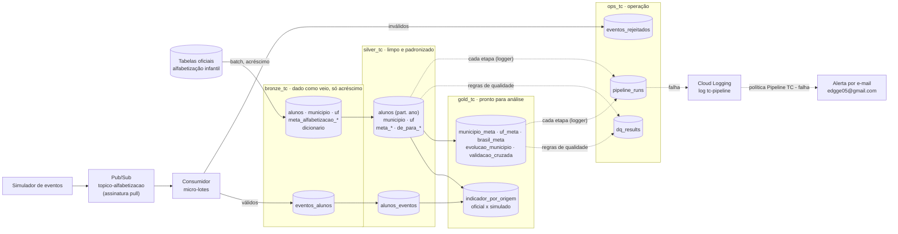

# Arquitetura implementada

Versão em imagem: [`arquitetura.png`](arquitetura.png).

O diagrama mostra **só o que existe no projeto em 28/10/2026**, conferido pelo catálogo (`docs/catalogo/catalogo_dados.md`). Linhas tracejadas são fluxos de controle ou observabilidade. A Silver e a Gold gravam em `pipeline_runs`; a Bronze e o streaming ainda não usam o logger. Os itens marcados como *pendente* ou *a confirmar* ainda não foram verificados no projeto.

## O que cada parte guarda

| Dataset | Tabelas | Linhas | Tamanho |
|---|---:|---:|---:|
| `bronze_tc` | 9 | 7.805.967 | 972,63 MiB |
| `silver_tc` | 9 | 3.930.225 | 803,77 MiB |
| `gold_tc` | 6 | 58.638 | 5,41 MiB |
| `ops_tc` | 3 tabelas e 1 view (`vw_custo_por_etapa`); `pipeline_runs` tem só as 4 linhas dos testes de 26/10 e 28/10 | 192 | 31,31 KiB |

**Região:** `southamerica-east1`. **Ambiente:** faturamento ativo (conferido em 28/10/2026; antes, BigQuery Sandbox). As tabelas criadas no Sandbox mantêm a data de expiração: 15/12 (Bronze) e 22/12 (Silver e Gold).
